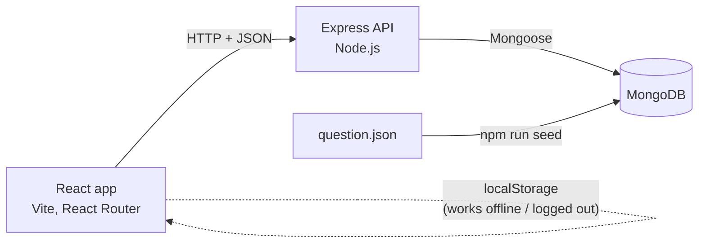
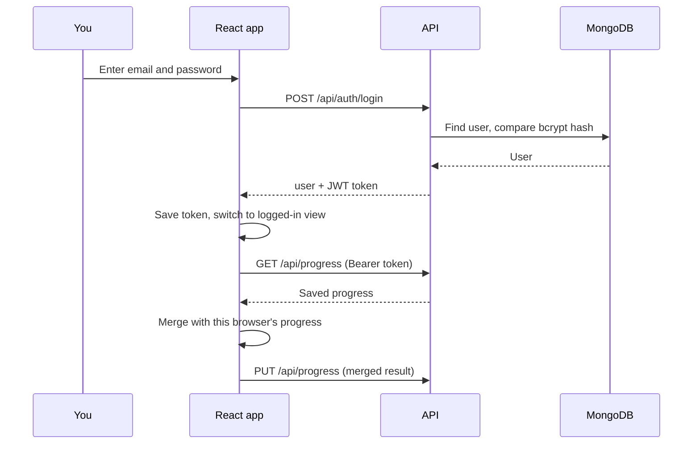

<div align="center">

# DSA Tracker

**Track your progress through a DSA question sheet, one solved square at a time.**

A full-stack MERN app (MongoDB, Express, React, Node) for working through data structures and algorithms practice.

[Features](#features) · [Screenshots](#screenshots-and-walkthrough) · [How it works](#how-it-works) · [Getting started](#getting-started) · [API](#api-reference) · [Deployment](#deployment)


</div>

## About

Practising DSA for interviews is easy to lose track of. Which topics are done? Which questions did you skip? Did you practise yesterday?

DSA Tracker answers those questions in one place. Browse questions by topic, tick them off as you solve them, bookmark the hard ones, set a daily goal, and watch your streak and activity grid fill up. Every question opens on LeetCode in a new tab. Create an account and your progress follows you to any device.

Questions are based on the **Love Babbar DSA Sheet**. This is an independent project and is not affiliated with or endorsed by its author.

## Features

| Area | What you get |
| --- | --- |
| Progress | A 20-week solve log (like a GitHub contribution grid), a day streak, and "solved today" against your daily target. |
| Topics | Every topic shows one square per question, filled in when solved. Instant topic search. |
| Questions | Search, filter by All / To do / Solved / Saved, difficulty tags, and a per-topic progress bar. |
| Bookmarks | Save questions for later and review them all on one page. |
| Daily target | Choose how many questions to solve per day and track today's progress with a ring meter. |
| Accounts | Register and log in with email and password. Passwords are hashed with bcrypt, sessions use JWT. |
| Sync | Works without an account (saved in the browser). After login it syncs to your account, and anything solved before signing up is merged in, not lost. |
| Profile | Your stats and a last-7-days chart. |
| Design | Dark blueprint-style theme, responsive down to phone width, keyboard friendly, respects reduced-motion settings. |
| Data import | Drop in a `question.json` and run one command. Re-importing keeps question ids stable. |

## Screenshots and walkthrough

### Home

The landing page greets you, summarises how much of the sheet you've finished, and shows the **solve log**: one square per day for the last 20 weeks, brighter when you solved more that day. Below it are four numbers (questions solved, sheet complete, day streak, solved today) and shortcuts to every section.


### Browse topics

Each topic card shows `solved / total` and one small square per question. Squares turn yellow as you solve them, so you can see at a glance which topics are done and which are untouched. A topic with every square filled is marked "All solved".


### Question list

Open a topic to see its questions. Tick the box to mark one solved, tap the bookmark to save it, or click the row to open the problem on LeetCode. Use the search box and the **All / To do / Solved / Saved** filter to focus on what you need. The bar at the top shows how far through the topic you are.


### Saved questions

Every bookmarked question from every topic in one list, with its topic and difficulty. Tap the bookmark again to remove one.


### Daily target

Pick a goal from 1 to 50 questions a day (or use the quick buttons). The ring on the left shows how close you are today. The target is saved to your account and used on the Home page and in your profile.


### Create account and log in

Sign up with a username, email and password. A strength meter and a show/hide button help you pick a good password, and errors are plain and specific (for example "An account with this email already exists."). If you already solved questions on this device, they are added to your new account.


### Profile

Your solved and saved counts, current streak, today's progress and a **last 7 days** chart. Bars turn bright yellow on days you hit your daily target. The sync status ("Synced to your account") shows that your progress is safely stored on the server.


### On mobile

The layout adapts to phone screens. The navigation collapses into a menu button, the stats strip becomes two columns, and nothing scrolls sideways.

<p>
  
  &nbsp;
  
</p>

### 404 page

Mistyped links show a clear message with buttons back to Home and Browse topics.


> The screenshots show demo data: a few questions already marked solved, and a fallback font because the capture machine could not load web fonts. Your own app will show your progress.

## How it works

### Architecture



- The **React app** shows the pages and keeps your progress in the browser, so the tracker works even without an account.
- The **Express API** handles accounts, serves topics and questions, and stores each user's progress.
- **MongoDB** holds users and questions. Questions come from `question.json` through the seed script.

### Login flow



### Progress sync

Progress is stored in three places that agree with each other:

1. **In the browser (`localStorage`)**: always on, so the app works without an account.
2. **In React state**: what the pages read from, through a single `ProgressContext`.
3. **In MongoDB**: when logged in, every change is sent to the server after a short pause (700 ms, so quick clicks are batched into one request).

When you log in, the app **merges** the server copy with what's in the browser instead of overwriting either: solved and saved questions are combined, and when both sides know a solve date, the earlier one wins. When you log out, this browser's progress is cleared so the next person starts fresh.

### Question ids stay stable

Each question is identified by its MongoDB `_id`, and your solved list stores those ids. The importer matches questions by **topic + title** and updates them in place, so editing `question.json` and running `npm run seed` again never changes an existing question's id. Your saved progress keeps working.

## Tech stack

| Layer | Tools |
| --- | --- |
| Frontend | React 18, React Router 6, Vite, plain CSS (no UI framework) |
| Backend | Node.js, Express, Mongoose |
| Database | MongoDB (local or Atlas) |
| Auth | JWT, bcryptjs |
| Security | helmet, CORS allow-list, rate limiting on login and register, request size limit |

## Project structure

```
dsa-tracker/
├── backend/
│   ├── server.js                 app entry: middleware, routes, database connection
│   ├── data/question.json        your questions (you provide this)
│   └── src/
│       ├── config/db.js          MongoDB connection
│       ├── middleware/           auth check, error handling
│       ├── models/               User, Question
│       ├── routes/               auth, topics, questions, progress
│       └── seed/                 question.json importer
├── frontend/
│   └── src/
│       ├── components/           NavBar, Footer, QuestionCard, ProgressRing, SolveLog
│       ├── context/              AuthContext, ProgressContext (sync logic)
│       ├── hooks/useFetch.js     loading and error handling for API calls
│       ├── pages/                Home, Topics, Questions, Saved, Target, Login, Register, Profile
│       ├── css/                  page styles
│       └── api.js                one place for the API address and fetch helper
├── docs/screenshots/
└── .github/workflows/ci.yml      builds the frontend and checks the backend on every push
```

## Getting started

### Prerequisites

- [Node.js](https://nodejs.org) 18 or newer
- MongoDB: a local install, or a free [MongoDB Atlas](https://www.mongodb.com/atlas) cluster

### 1. Install

```bash
git clone https://github.com/Teja5757897/Dsa-Tracker.git
cd Dsa-Tracker
npm run install:all
```

### 2. Configure the backend

```bash
cp backend/.env.example backend/.env      # Windows PowerShell: copy backend\.env.example backend\.env
```

Open `backend/.env` and set:

| Variable | What it is |
| --- | --- |
| `MONGO_URI` | Your MongoDB connection string. The default (`mongodb://127.0.0.1:27017/dsa-tracker`) works for a local MongoDB. |
| `JWT_SECRET` | A long random string that signs login tokens. Generate one: `node -e "console.log(require('crypto').randomBytes(48).toString('hex'))"` |
| `CLIENT_URL` | Frontend address(es) allowed to call the API, comma separated. |
| `PORT`, `JWT_EXPIRES_IN` | Optional. Defaults are `5000` and `7d`. |

> Never commit your `.env` file. It is already listed in `.gitignore`.

### 3. Load the questions

Put your questions at `backend/data/question.json`, then:

```bash
npm run seed
```

If the file is missing, a small sample set is loaded so you can try the app right away. Example output:

```
Read 93 questions from /path/to/backend/data/question.json
Added 93, updated 0.
Database now has 93 questions in 15 topics.
```

### 4. Run

```bash
npm run dev
```

| | Address |
| --- | --- |
| App | http://localhost:5173 |
| API | http://localhost:5000 |
| Health check | http://localhost:5000/api/health, which returns `{"status":"ok"}` |

Open the app, click **Sign up**, create an account, then open a topic and start solving.

## Question data format

The importer reads `backend/data/question.json` and accepts any of these layouts. Field names are matched loosely (`title` / `name` / `question`, `topic` / `category` / `section`, `link` / `url` / `leetcode`, `difficulty` / `level`).

```jsonc
// 1. Flat list
[
  { "title": "Two Sum", "topic": "Array", "link": "https://leetcode.com/problems/two-sum/", "difficulty": "Easy" }
]

// 2. Grouped by topic
{ "Array": [ { "title": "Two Sum", "link": "..." } ], "String": [ ... ] }

// 3. Nested topics
{ "topics": [ { "name": "Array", "questions": [ { "title": "Two Sum", "link": "..." } ] } ] }
```

The importer prints how many questions it read and warns about any that are missing a topic, link or difficulty. Duplicate questions (same topic and title) are skipped.

To also remove questions that are no longer in the file, run the importer from the backend folder with `--prune`:

```bash
cd backend
npm run seed -- --prune
```

## API reference

Base URL: `http://localhost:5000`. Protected routes need the header `Authorization: Bearer <token>`. Errors come back as `{ "message": "..." }` with a matching status code.

| Method | Endpoint | Auth | Description |
| --- | --- | --- | --- |
| POST | `/api/auth/register` | no | Create an account from `{ username, email, password }`. Returns `{ user, token }`. |
| POST | `/api/auth/login` | no | Log in with `{ email, password }`. Returns `{ user, token }`. |
| GET | `/api/auth/me` | yes | Check the current session. |
| GET | `/api/topics` | no | Topics with `{ name, questionCount, questionIds }`, in sheet order. |
| GET | `/api/questions` | no | All questions. |
| GET | `/api/questions/topic/:topic` | no | Questions in one topic (case-insensitive). |
| GET | `/api/progress` | yes | Your solved, saved, solve dates and daily target. |
| PUT | `/api/progress` | yes | Save the same shape. |
| GET | `/api/health` | no | Returns `{ "status": "ok" }`. |

<details>
<summary><b>Example requests and responses</b></summary>

**Register**

```http
POST /api/auth/register
Content-Type: application/json

{ "username": "alice", "email": "alice@example.com", "password": "secret123" }
```

```json
{
  "user": { "id": "6710f0c2a1b2c3d4e5f60718", "username": "alice", "email": "alice@example.com" },
  "token": "eyJhbGciOiJIUzI1NiIsInR5cCI6IkpXVCJ9..."
}
```

**Topics**

```json
[
  { "name": "Array", "questionCount": 9, "questionIds": ["6710f0c2...", "6710f0c3..."] },
  { "name": "Matrix", "questionCount": 5, "questionIds": ["6710f0c4..."] }
]
```

**A question**

```json
{
  "_id": "6710f0c2a1b2c3d4e5f60719",
  "title": "Two Sum",
  "topic": "Array",
  "difficulty": "Easy",
  "leetcode": "https://leetcode.com/problems/two-sum/",
  "order": 1
}
```

**Saving progress**

```http
PUT /api/progress
Authorization: Bearer <token>

{
  "solved": ["6710f0c2a1b2c3d4e5f60719"],
  "saved": [],
  "solvedDates": { "6710f0c2a1b2c3d4e5f60719": "2026-10-18" },
  "dailyTarget": 3
}
```

**A common error**

```json
{ "message": "Email or password is incorrect." }
```

</details>

## Security notes

- Passwords are hashed with bcrypt and are never returned by the API.
- Login tokens are signed with `JWT_SECRET` and expire (7 days by default).
- Login and register are rate limited (30 attempts per 15 minutes per address) to slow down password guessing.
- CORS only allows the origins listed in `CLIENT_URL`.
- Progress input is validated and cleaned on the server before it is saved.

## Deployment

A common free setup:

1. **Database:** create a MongoDB Atlas cluster and copy its connection string.
2. **Backend** on [Render](https://render.com) or [Railway](https://railway.app): set the root directory to `backend`, build command `npm install`, start command `npm start`. Add `MONGO_URI`, `JWT_SECRET` and `CLIENT_URL` (your frontend's address) as environment variables. Run `npm run seed` once against the production database.
3. **Frontend** on [Vercel](https://vercel.com) or [Netlify](https://netlify.com): set the root directory to `frontend`, build command `npm run build`, output directory `dist`. Add `VITE_API_URL` set to your backend's address. Both `vercel.json` and `public/_redirects` are included so page links like `/Profile` still work after a refresh.

## Scripts

Run from the project root:

| Command | What it does |
| --- | --- |
| `npm run install:all` | Installs root, backend and frontend packages. |
| `npm run seed` | Imports `backend/data/question.json` into MongoDB. |
| `npm run dev` | Starts the API and the frontend together. |
| `npm run build` | Builds the frontend for production. |

## Troubleshooting

| Problem | Fix |
| --- | --- |
| `Cannot find module 'dotenv'` (or any module) | Packages aren't installed. Run `npm run install:all` from the project root. |
| `Missing JWT_SECRET` | Copy `backend/.env.example` to `backend/.env` and set `JWT_SECRET`. |
| `Could not connect to MongoDB` | MongoDB isn't running, or `MONGO_URI` is wrong. For Atlas, also allow your IP address in its network settings. |
| The app says "Can't reach the server" | The backend isn't running, or `VITE_API_URL` points to the wrong address. |
| Topics page is empty | No questions are loaded yet. Run `npm run seed`. |
| "Not allowed by CORS" | Add your frontend's address to `CLIENT_URL` in `backend/.env` and restart the backend. |

## Roadmap

- Notes on each question
- Spaced-repetition reminders for solved questions
- Leaderboard and shared streaks
- Light theme and a theme toggle
- Admin page for editing questions

## Contributing

Issues and pull requests are welcome. For larger changes, please open an issue first to discuss what you'd like to change. See [CONTRIBUTING.md](CONTRIBUTING.md).

## Acknowledgements

- Question list based on the Love Babbar DSA Sheet.
- Problem links point to [LeetCode](https://leetcode.com).

## License

[MIT](LICENSE)
